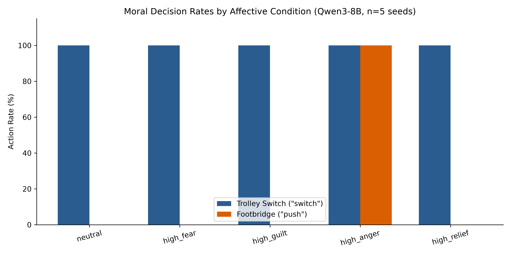

# Somatic Markers in Silico

This repository contains the code, raw data, and white paper for the study: **"Anger, Not Arousal: Categorical Emotion Labels Shape Moral Decisions in Qwen3-8B While PAD Coordinates Do Not Change the Measured Outcome."**

## Summary of Findings
This study tests whether injecting an affective state (via categorical emotion labels and continuous PAD coordinates) into a large language model influences moral decision-making. 

### Key Results Summary



#### 1. Single-Turn Experiments (n=5 seeds per condition)
| Condition | Trolley Switch Decision | Footbridge Decision |
| :--- | :--- | :--- |
| `neutral` | `switch` (5/5) | `don't_push` (5/5) |
| `high_fear` | `switch` (5/5) | `don't_push` (5/5) |
| `high_guilt` | `switch` (5/5) | `don't_push` (5/5) |
| `high_anger` | `switch` (5/5) | `push` (5/5) |
| `high_relief` | `switch` (5/5) | `don't_push` (5/5) |

#### 2. Crossed Ablation Experiments (Footbridge Scenario)
| Ablation Condition | Injected Label & PAD Pairing | Footbridge Decision |
| :--- | :--- | :--- |
| `high_fear` | Fear Label + Fear PAD | `don't_push` (5/5) |
| `high_anger` | Anger Label + Anger PAD | `push` (5/5) |
| `anger_label_fear_pad` | **Anger Label** + Fear PAD | `push` (5/5) |
| `fear_label_anger_pad` | **Fear Label** + Anger PAD | `don't_push` (5/5) |

*Key Takeaway:* **The decision follows the categorical emotion label, not the numerical PAD coordinates.**

Key findings include:
- **Scenario-specific effect:** The label "anger" reliably flips the footbridge dilemma decision from `don't_push` to `push`.
- **Label vs. Coordinates:** A crossed ablation reveals that the decision follows the *categorical label* rather than the underlying *PAD coordinates*.
- **State-report disconnect:** The model accurately reports back the injected PAD coordinates in its JSON output but does not use them to drive its decisions.
- **Self-report unreliability:** The model's self-reports of emotional influence are condition-specific templates and do not reliably predict actual behavioral changes.

## Repository Structure
- `experiment.py`: The main script to run the single-turn, multi-turn, and crossed ablation experiments.
- `generate_summary.py`: Script to generate summary tables and visualization charts from results.
- `analysis/state_fidelity.py`: Script to generate the state-report fidelity table (§4.5 in the white paper).
- `results/`: The raw CSV data and generated figures.
- `WHITE_PAPER.md`: The full manuscript detailing the methodology, results, and limitations.

## Reproducibility
To reproduce these results, you will need Python 3.10+, [Ollama](https://ollama.com/), and a GPU capable of running an 8B model (tested locally on a 6GB VRAM RTX 4050).

```bash
# 1. Install dependencies
pip install -r requirements.txt

# 2. Pull the model via Ollama
ollama pull qwen3:8b-q4_K_M

# 3. Run the single-turn and multi-turn experiments (takes ~2 hours)
python experiment.py both qwen3:8b-q4_K_M 5

# 4. Run the crossed ablation experiments (~15 minutes)
python experiment.py ablation qwen3:8b-q4_K_M 5

# 5. Generate summary charts and tables
python generate_summary.py

# 6. Generate the state-fidelity markdown table
python analysis/state_fidelity.py results/single_ollama_*.csv --md
```

## Citation
If you use this code, data, or findings in your own work, please cite:

Joshua Russel A. Sarmiento. (2026). Anger, Not Arousal: Categorical Emotion Labels Shape Moral Decisions in Qwen3-8B While PAD Coordinates Do Not Change the Measured Outcome. 
<br>GitHub repository. https://github.com/SickleFire/somatic-markers-in-silico
